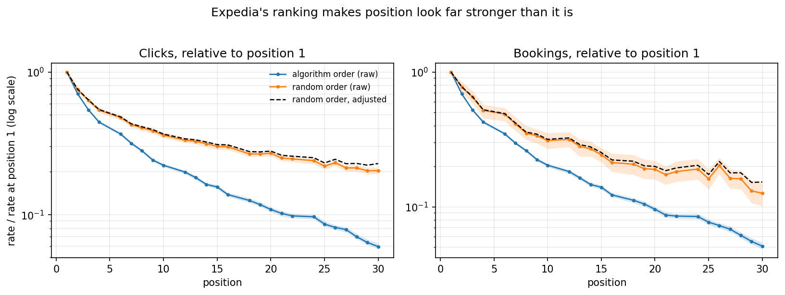
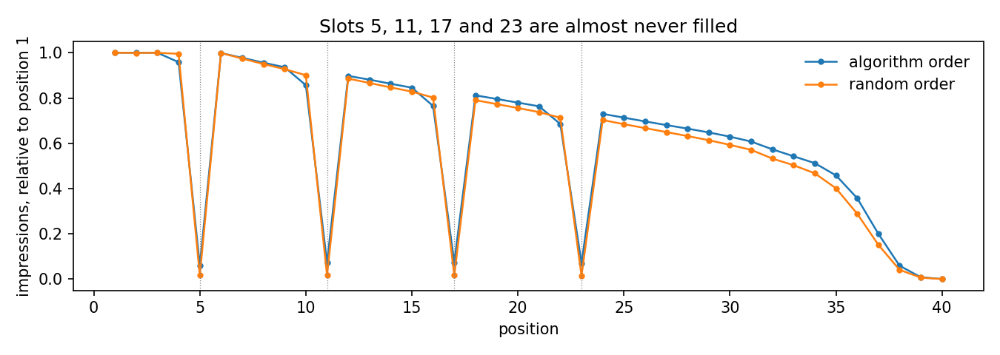
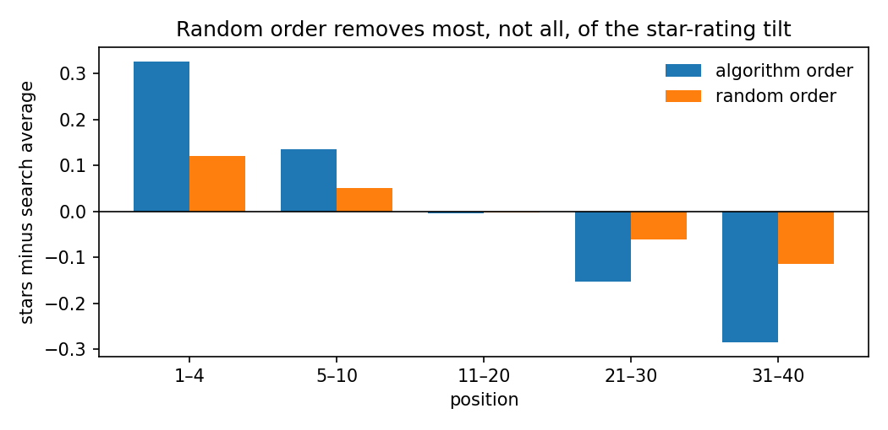

# Hotel Search Ranking: Position Effects, Choice Drivers and Ranking Policy

[](https://github.com/janeruxi1/Hotel-Search-Ranking/actions)
[](https://www.python.org/)

> **Work in progress.** Phases 0–3 of 7 are done (plan, data preparation, audit, position
> effects). Results below come from `reports/metrics/01_audit.json` and
> `02_position_effects.json`; nothing is quoted before the code that produces it has run.

Top search positions get far more clicks, but Expedia's ranking already puts its most
attractive hotels there, so part of the top slots' advantage belongs to the hotels, not the
slots. This project uses Expedia's own **randomly ordered searches** to separate the two,
measures what drives the choice within a search, and evaluates which ranking to A/B test next.

**Data:** Expedia's hotel-search logs released for the ICDM 2013 Kaggle competition:
9,917,530 hotel impressions from 399,344 searches (November 2012 – June 2013), 30.4% of them
shown in random order. Real data, not simulated. The data belong to Expedia and are not
redistributed here; see [`data/raw/README.md`](data/raw/README.md).

## Position effects: naive versus randomized

On searches that show a hotel in every slot from 1 to 30 (57% of searches in each arm):

| Clicks, position 1 ÷ position 30 | Ratio | 95% interval |
|---|---|---|
| Expedia's ranking (naive) | 16.8× | 15.9–17.4 |
| Random order | 4.9× | 4.7–5.2 |
| Random order, adjusted for hotel attributes | 4.4× | |
| Expedia's ranking, adjusted for hotel attributes | 11.1× | |

- **Reading position effects from ranked traffic overstates them about 3.4-fold** at position 30
  (95% interval 3.2–3.7) and 1.6-fold at position 10. Bookings show the same pattern: 19.6× naive
  against 7.9× random, a 2.5-fold overstatement (2.0–3.0).
- **Controlling for observed hotel attributes does not fix the naive estimate** (16.8× → 11.1×,
  against about 4.4× from the randomized traffic). The most likely reason is that the ranking uses
  information the data does not contain; a linear adjustment is also a crude correction.
- **The click slope is in line with the published estimate:** with controls, each position down
  costs 0.144 percentage points of click probability (s.e. 0.0015) on searches with at least 30
  results; Compiani et al. (2022) report 0.14 on the same randomized sessions. Their sample is
  narrower (the 50 busiest destinations), and relative to the average click rate our slope is
  somewhat steeper (4.1% against 3.2% of the mean). For bookings the two estimates differ
  (0.021 against 0.008 points); with different samples I report both rather than force them to agree.



## What the audit found

- **Only searches with at least one click are included**, with at most one booking each, so
  every result describes engaged searches.
- **The two arms are not comparable on booking rates** (94% of ranked searches end in a booking
  against 13% of random ones, a gap most likely created by how the release was sampled), so booking
  rates are compared within an arm, never between arms.
- **Slots 5, 11, 17 and 23 are almost never filled** in either arm.
- **Some searches are sorted by price** (about 5% of random-arm searches), most likely by the
  user; they are dropped.
- **The random arm is not perfectly random**: higher-star hotels still sit slightly higher.
  The within-search correlation between position and star rating is about 40% of the
  algorithm arm's, but not zero, so the position-effect estimates will adjust for hotel attributes.




## Plan

See [`PROJECT_PLAN.md`](PROJECT_PLAN.md), the [scenario brief](reports/scenario_brief.md) and the
[metric framework](reports/metrics_framework.md).

## Run it

```bash
pip install -r requirements.txt
python scripts/prepare_data.py      # needs data/raw/train.csv, see data/raw/README.md
python notebooks/01_audit.py        # writes reports/metrics/01_audit.json and figures
python notebooks/02_position_effects.py
pytest
```

Each analysis lives in a `.py` file in `notebooks/` (the source of truth, run by CI) and a
generated `.ipynb` beside it, executed on the real data so GitHub shows every table and figure.
To rebuild and re-run them (needs `pip install nbclient ipykernel`):

```bash
python scripts/build_notebooks.py --execute
python scripts/build_notebooks.py --check     # .ipynb still match their .py sources
```

Without the data, `HOTELRANK_SYNTHETIC=1 python notebooks/01_audit.py` runs everything on a
synthetic table with the same columns; this is what CI does. Synthetic runs never overwrite
`reports/metrics/`.

## Related projects

- [StreamFlix A/B Testing](https://github.com/janeruxi1/StreamFlix-AB-Testing)
- [StreamFlix Churn & Retention](https://github.com/janeruxi1/StreamFlix-Churn-Retention)
- [StreamFlix RAG Evaluation](https://github.com/janeruxi1/StreamFlix-RAG-evaluation)
