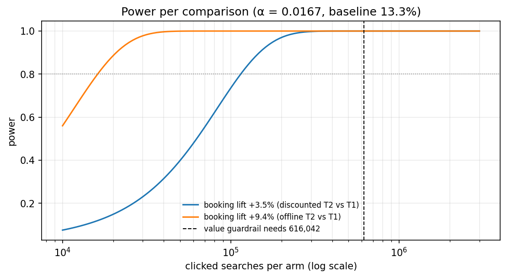
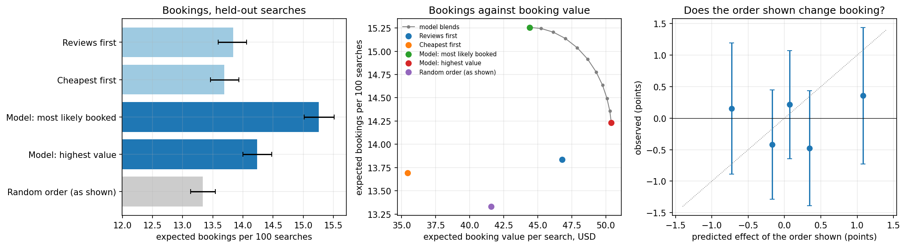
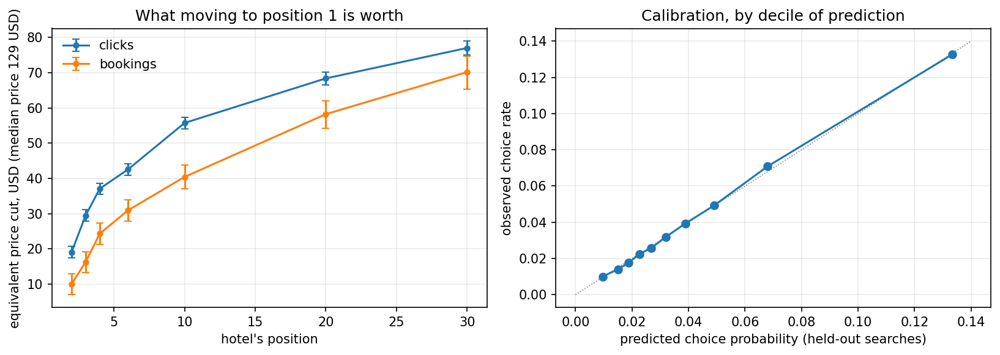

# Hotel Search Ranking: Position Effects, Choice Drivers and Ranking Policy

[](https://github.com/janeruxi1/Hotel-Search-Ranking/actions)
[](https://www.python.org/)

[](https://janeruxi1-hotel-search-ranking.streamlit.app/)

**[Decision memo](reports/decision_memo.md)** · **[Live demo](https://janeruxi1-hotel-search-ranking.streamlit.app/)** ·
**[Notebooks](notebooks/)** · Every number below comes from `reports/metrics/`, and CI checks the key
numbers quoted here and in the memo against those records.

Top search positions get far more clicks, but Expedia's ranking already puts its most
attractive hotels there, so part of the top slots' advantage belongs to the hotels, not the
slots. This project uses Expedia's own **randomly ordered searches** to separate the two,
measures what drives the choice within a search, and evaluates which ranking to A/B test next.

**Data:** Expedia's hotel-search logs released for the ICDM 2013 Kaggle competition:
9,917,530 hotel impressions from 399,344 searches (November 2012 – June 2013), 30.4% of them
shown in random order. Real data, not simulated. The data belong to Expedia and are not
redistributed here; see [`data/raw/README.md`](data/raw/README.md).

**What the project shows:** separating a causal effect from selection using randomized traffic
already in the logs; a discrete choice model that prices position, promotions and quality in
dollars; offline evaluation of ranking policies against a decision rule written before the
results; and the A/B test that would settle what offline analysis cannot.

## Recommendation

From the [decision memo](reports/decision_memo.md):

- **Don't test "cheapest first"**, the change originally proposed: offline it loses to a simple
  reviews-first sort on both bookings and booking value.
- **A/B test two candidates against the current ranking:** reviews first (the pre-declared rule's
  pick) and a blend of the model rankings (exploratory: better on both metrics offline, found after looking).
- **Size:** 616,042 clicked searches per arm, set by the 2% booking-value guardrail rather than
  by the booking lift (114,487 per arm). The sizing discounts the offline lift because the check
  of its mechanism was inconclusive; the margin of the guardrail is a business decision.



## Which ranking to test

Four rankings compared on 23,165 held-out random-order searches, with a booking model
(including the option to book nothing) fitted on the other 91,516. The decision rule
was committed before this analysis ([`reports/decision_rule.md`](reports/decision_rule.md)).

| Ranking | Expected bookings per 100 searches | Expected booking value per search |
|---|---|---|
| Reviews first | 13.84 | $46.79 |
| Cheapest first (the proposal) | 13.69 | $35.44 |
| Model: most likely to be booked | 15.26 | $44.41 |
| Model: highest expected value | 14.23 | $50.41 |
| Random order, as shown (reference) | 13.33 | $41.57 |

- **Cheapest first loses on both counts:** −0.15 bookings per 100 searches
  against reviews first, and −24% booking value. The proposed change should not be tested.
- **The pre-declared rule recommends reviews first.** The model ranking with the most bookings
  (+10% against reviews first) gives up 5.1% of booking value, more than the 2% the rule allows.
- **Beyond the rule (exploratory):** blends of the two model rankings beat reviews first on both
  metrics in point estimates (for example, 15.14 bookings per 100 searches and $47.04 per search). The rule only
  considered the bookings-maximising model ranking; the blend is the natural candidate for a test,
  flagged as found after the fact rather than substituted for the rule's answer.
- **Two robustness checks.** The framework's other guardrails hold for the blend (1.23% of
  bookings at hotels with no reviews against 1.31% for reviews first and 2.81% for cheapest first;
  booked hotel $138 a night against $151), and cross-fitting shows the evaluator does not flatter
  rankings built from its own model (15.25 against 15.26 bookings per 100 searches for the best
  model ranking, scored by a model fitted on other searches).
- **The biggest caveat:** the gains come from the model's view that a better top of the page makes
  a booking more likely at all. On held-out searches, the evaluator is well calibrated overall
  (13.33% predicted vs 13.18% observed), but the direct check of that mechanism
  is inconclusive (slope 0.37, 95% interval −0.28 to 1.02; 1 would confirm it, 0 would refute it).
  Offline evaluation can choose what to test; only an A/B test can say how much it is worth.



## Position effects: naive versus randomized

On searches that show a hotel in every slot from 1 to 30 (57% of searches in each arm):

| Clicks, position 1 ÷ position 30 | Ratio | 95% interval |
|---|---|---|
| Expedia's ranking (naive) | 16.8× | 15.9–17.4 |
| Random order | 4.9× | 4.7–5.2 |
| Random order, adjusted for hotel attributes | 4.4× | |
| Expedia's ranking, adjusted for hotel attributes | 11.1× | |

- **Reading position effects from ranked traffic overstates them about 3.4-fold** at position 30
  (95% interval 3.2–3.7) and 1.6-fold at position 10. Bookings show the same pattern: 19.6× naive
  against 7.9× random, a 2.5-fold overstatement (2.0–3.0). The click comparison is the cleaner
  one: the release kept far more booking searches in the ranked arm, so the booking curves come
  from differently selected samples.
- **Controlling for observed hotel attributes does not fix the naive estimate** (16.8× → 11.1×,
  against about 4.4× from the randomized traffic). The most likely reason is that the ranking uses
  information the data does not contain; a linear adjustment is also a crude correction.
- **The click slope is in line with the published estimate:** with controls, each position down
  costs 0.144 percentage points of click probability (s.e. 0.0015) on searches with at least 30
  results; Compiani et al. (2022) report 0.14 on the same randomized sessions. Their sample is
  narrower (the 50 busiest destinations), and relative to the average click rate our slope is
  somewhat steeper (4.1% against 3.2% of the mean). For bookings the two estimates differ
  (0.021 against 0.008 points); with different samples I report both rather than force them to agree.


## What drives the choice within a search

A conditional logit on the randomly ordered searches (106,614 searches with one click; 15,203
with a booking) puts every effect on one scale: the price cut that would move choice
probability by the same amount. Dollars use the median price in the sample ($129 a night).

| Worth the same as a price cut of… | Clicks | Bookings |
|---|---|---|
| Position 1 instead of 2 | $19 (15%) | $10 (8%) |
| Position 1 instead of 10 | $56 (43%) | $40 (31%) |
| Position 1 instead of 30 | $77 (60%) | $70 (55%) |
| A promotion flag | $19 (15%) | $21 (16%) |
| One more star | $19 (15%) | $16 (13%) |
| One more review point | $10 (8%) | $15 (11%) |

- **Price sensitivity:** a hotel 10% dearer than usual is clicked about 15% less often (price
  coefficient −1.75 for clicks, −2.64 for bookings).
- **Controlling for the hotel's usual price matters:** without it, the price coefficient is
  −0.79, less than half as large, because dearer hotels tend to be better in ways the data
  does not record. With it, price sensitivity is identified by the same hotel being cheaper or
  dearer than usual.
- **4–5 star hotels see slightly more price sensitivity, not less** (−1.90 against −1.60).
- **Consistent with the position analysis:** the model implies position 1 vs 30 odds of
  4.9×, in line with the 4.4–4.9× measured directly.
- **Out of sample:** on held-out searches the hotel the model rates most likely is the one clicked 14.8% of the time
  (a random guess: 5.5%), and predicted probabilities are well calibrated.
- **Caveat:** price was never randomized. If hotels raise prices when demand is high, price
  sensitivity is understated and the dollar values above are upper bounds.



## Data preparation in SQL

The search-level work of the audit is SQL ([`sql/`](sql/)), run by DuckDB directly on the 9.9M-row
Parquet file: one row per search, the arm summary, the reserved-slot check (`LAG`/`LEAD` over a
generated grid of slots), the data-quality flags and the analysis sample. The flag for searches the
user sorted by price is a within-search rank correlation built from window functions. Notebook 01
saves these flags, and every later notebook reads them. `tests/test_sql.py` checks each query
against an independent pandas implementation in CI.

## What the audit found

- **Only searches with at least one click are included**, with at most one booking each, so
  every result describes engaged searches.
- **The two arms are not comparable on booking rates** (94% of ranked searches end in a booking
  against 13% of random ones, a gap most likely created by how the release was sampled), so booking
  rates are compared within an arm, never between arms.
- **Slots 5, 11, 17 and 23 are almost never filled** in either arm.
- **Some searches are sorted by price** (about 5% of random-arm searches), most likely by the
  user; they are dropped.
- **The random arm is not perfectly random**: higher-star hotels still sit slightly higher.
  The within-search correlation between position and star rating is about 40% of the
  algorithm arm's, but not zero, so the position-effect estimates will adjust for hotel attributes.


## Plan

See [`PROJECT_PLAN.md`](PROJECT_PLAN.md), the [scenario brief](reports/scenario_brief.md) and the
[metric framework](reports/metrics_framework.md).

## Run it

```bash
pip install -r requirements.txt
python scripts/prepare_data.py      # needs data/raw/train.csv, see data/raw/README.md
python notebooks/01_audit.py        # writes reports/metrics/01_audit.json and figures
python notebooks/02_position_effects.py
python notebooks/03_choice_model.py
python notebooks/04_policy_evaluation.py
python notebooks/05_ab_test_design.py
pytest
```

Each analysis lives in a `.py` file in `notebooks/` (the source of truth, run by CI) and a
generated `.ipynb` beside it, executed on the real data so GitHub shows every table and figure.
To rebuild and re-run them (needs `pip install nbclient ipykernel`):

```bash
python scripts/build_notebooks.py --execute
python scripts/build_notebooks.py --check     # .ipynb still match their .py sources
```

Without the data, `HOTELRANK_SYNTHETIC=1 python notebooks/01_audit.py` runs everything on a
synthetic table with the same columns; this is what CI does. Synthetic runs never overwrite
`reports/metrics/`.

## Repository layout

```
reports/decision_memo.md     the recommendation, under the pre-declared rule
reports/decision_rule.md     the rule, committed before phase 4 ran
reports/metrics/*.json       every result, written by the notebooks (aggregates only)
notebooks/0N_*.py / .ipynb   one notebook per phase; .py is the source, .ipynb is executed on real data
sql/                         DuckDB SQL for the search-level audit and the analysis sample (used by notebook 01)
src/hotelrank/               audit, position effects, choice model, policy evaluation, test sizing, demo helpers
app/streamlit_app.py         the live demo; reads only reports/metrics
tests/                       unit tests, notebook sync, demo smoke tests, memo/README numbers against records
```

## Run the demo locally

```bash
pip install -r app/requirements.txt
streamlit run app/streamlit_app.py
```

The demo needs no data download: it reads the aggregate records in `reports/metrics/`.

## Related projects

- [StreamFlix A/B Testing](https://github.com/janeruxi1/StreamFlix-AB-Testing)
- [StreamFlix Churn & Retention](https://github.com/janeruxi1/StreamFlix-Churn-Retention)
- [StreamFlix RAG Evaluation](https://github.com/janeruxi1/StreamFlix-RAG-evaluation)
